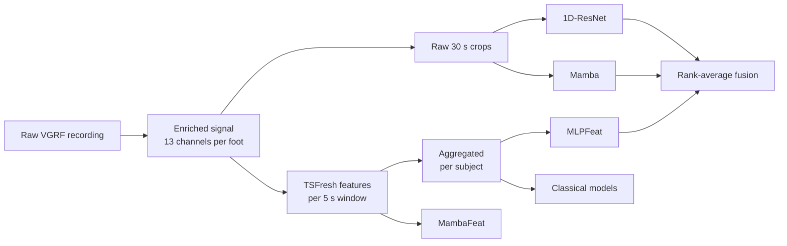

# Automatic Detection of Parkinson's Disease Using Gait Signals and State Space Models

Gait changes early in Parkinson's disease (PD), and pressure insoles can measure those changes objectively. This project asks one question:

> Do selective state space models (Mamba) improve subject-level detection of Parkinson's disease from gait signals over classical baselines?

**Answer: Mamba is competitive, but not superior.** Nine models and a late fusion were compared on vertical ground reaction force (VGRF) recordings from 100 subjects, under one leakage-free, subject-level protocol on five fixed folds.

## Key findings

| Finding | Evidence |
|---|---|
| Mamba matches the other deep models but does not beat them | Combined feet: Mamba 0.78 accuracy / 0.88 AUC, 1D-ResNet 0.80 / 0.89. No pairwise difference among the four deep models is significant (smallest p = 0.135). |
| Fusion gives the best combined-feet accuracy | 1D-ResNet + Mamba + MLPFeat: 0.86 accuracy, 0.91 AUC |
| Classical baselines on good features are fully competitive | Combined feet: 0.80 to 0.83 accuracy, 0.89 to 0.91 AUC |
| Features help the conventional network more than Mamba | Moving from raw signal to features adds 0.028 AUC for the conventional network (0.888 to 0.916) and 0.002 for Mamba (0.876 to 0.878) |
| The decision threshold matters more than the architecture | The threshold policy alone moved Mamba's left-foot accuracy from 0.69 to 0.80 |
| Cross-validation estimates held up on unseen data | Mamba on 44 unseen recordings: 79.5% accuracy, against 0.78 in cross-validation |

## Pipeline

One enriched signal gives three representations, which feed three model families. All preprocessing is fitted on training data only.



## Dataset

The data comes from the [PhysioNet Gait in Parkinson's Disease database](https://physionet.org/content/gaitpdb/1.0.0/). Subjects walked with 8 force sensors under each foot, sampled at 100 Hz. The recordings come from three studies with different protocols, identified by the file prefixes `Ga`, `Ju` and `Si`.

Demographics of the full database:

| | PD | Control |
|---|---|---|
| Male / Female | 58 / 35 | 40 / 33 |
| Age (years) | 66.9 ± 9.7 | 63.3 ± 8.0 |
| Height (m) | 1.68 ± 0.10 | 1.68 ± 0.08 |
| Weight (kg) | 72.3 ± 11.8 | 72.3 ± 11.4 |
| Hoehn & Yahr | 2.26 ± 0.34 | n/a |
| UPDRS motor | 18.0 ± 9.6 | n/a |

This project uses 100 of these subjects in five predefined folds, stored in `splits/`. Each fold has 60 training, 20 validation and 20 test subjects, and every split is 50% PD.

```
splits/
  Fold_1/
    training/      60 recordings
    validation/    20 recordings
    test/          20 recordings
  Fold_2/ ... Fold_5/
```

### File format

Each `.txt` file has 19 columns. The label comes from the file name: `Pt` means PD and `Co` means control, as in `GaPt22_01.txt`.

| Column | Content |
|---|---|
| 1 | Time (s) |
| 2 to 9 | VGRF (N), 8 sensors, left foot |
| 10 to 17 | VGRF (N), 8 sensors, right foot |
| 18 | Total force, left foot |
| 19 | Total force, right foot |

### Enriched signal

Five seconds are trimmed from each end of a recording, because subjects stand still there. Each foot is then described by 13 channels. The three foot settings used throughout are Left (13 channels), Right (13 channels) and Combined (26 channels).

| Channels | Content |
|---|---|
| 1 to 8 | Raw VGRF sensors |
| 9 | Total force |
| 10 | `COP_x`: medio-lateral centre of pressure |
| 11 | `COP_y`: antero-posterior centre of pressure |
| 12 | Heel load: sum of the posterior sensors |
| 13 | Toe load: sum of the anterior sensors |

### What the signals show

The average gait cycle looks almost the same in both groups. What differs is consistency: patients show a wider spread and a higher force coefficient of variation (88 to 89% against 77%). PD gait is less consistent, not differently shaped.

The feature space shows the same pattern. The first two principal components explain only 7.0% and 5.2% of the variance, and it takes 23 components to reach half. Neither PCA nor t-SNE separates the groups in two dimensions, where a 5-nearest-neighbour vote recovers the diagnosis only 55 to 56% of the time. Yet a logistic regression reaches AUC 0.66 on 2 components, 0.83 on 10 and 0.86 on 20, so the signal is real but spread over many directions.

## Models

### Classical models

1. **Extract:** TSFresh (`efficient` feature set) on 5 s windows with a 2.5 s step, summarised per subject by mean, standard deviation, skewness and kurtosis.
2. **Preprocess:** clean, z-score, then `SelectKBest` with an ANOVA F-test (up to 300 features). The RBF SVM also uses PCA (up to 50 components).
3. **Tune:** grid search by validation AUC.
4. **Test:** refit on training and validation data, then make one pass over the test fold.

| Model | Search grid |
|---|---|
| Random Forest | `n_estimators` 300, 600; `max_depth` None, 10, 20; `max_features` sqrt, 0.3 |
| Extra Trees | `n_estimators` 300, 600; `max_depth` None, 10, 20; `max_features` sqrt, 0.3 |
| Logistic Regression | `C` 0.01 to 100 |
| Linear SVM | `C` 0.01 to 100 |
| RBF SVM | `C` 0.1 to 100; `gamma` scale, 0.01, 0.001 |

### Deep models

The four deep models form a two-by-two design: conventional network against state space model, and raw signal against TSFresh features.

| | Raw signal | TSFresh features |
|---|---|---|
| **Conventional network** | 1D-ResNet | MLPFeat |
| **State space model** | Mamba | MambaFeat |

| Model | Input | Architecture | Parameters (Combined) |
|---|---|---|---|
| 1D-ResNet | 30 s crops, about 190 positions after the stem | Strided convolutional stem, 3 residual stages (64, 128, 256 channels), gated attention pooling, linear head | 2.25 M |
| Mamba | 30 s crops, about 190 tokens after the stem | Convolutional stem, 4 bidirectional S6 layers (width 128, state size 16), gated attention pooling, linear head | 1.01 M |
| MambaFeat | 48 consecutive 5 s windows (about 2 minutes), 256 ANOVA-selected TSFresh features per window | 2 bidirectional S6 layers (width 64), attention pooling, linear head | 0.16 M |
| MLPFeat | One vector per subject: the 300 selected aggregated features | Hidden layers of 128 and 64 units with batch normalisation, GELU and dropout 0.5 | 47 k |

The core of Mamba is a selective state space layer: a hidden state runs along the sequence, and how much it keeps or overwrites at each step is computed from the input. Gait inside a crop is not causal, so each layer scans forwards and backwards.

For the crop-based models, a subject's score is the mean over crops of the recording. Every deep result is a five-seed ensemble (seeds 42 to 46). Exact training settings are in `src/config.py`.

Mamba uses the official `mamba-ssm` CUDA kernels when they are installed. Otherwise it falls back to the pure-PyTorch S6 implementation in `src/mamba_block.py`, which is equivalent but slower.

### Late fusion

Fusion combines saved per-subject scores, so nothing is retrained:

1. Rank-transform each model's scores within the fold, which puts all models on one scale.
2. Average 1D-ResNet, Mamba and MLPFeat, one model per family.
3. Set the threshold at the class-mean midpoint of the fused validation scores.

### Other models in the code

These are available through `--dl-models` but are not part of the main results above.

| Name | Description |
|---|---|
| `LSTM` | CNN-LSTM on 5 s windows |
| `ResNet1D`, `MambaWin` | ResNet and Mamba on 5 s windows with attention pooling |
| `ResNetSeq5`, `Mamba5` | ResNet and Mamba on 5 s crops |
| `MambaGait`, `ResNetGait` | Stride-segmented models |

## Evaluation protocol

- **Subject-level:** predictions and metrics are per subject, and a subject's recording appears in only one split of a fold.
- **No leakage:** cleaning, scaling, feature selection and PCA are fitted on the training split of each fold only.
- **Test once:** each test fold is evaluated once. Fusion uses a combination fixed in advance, not the top of a leaderboard.
- **Metrics:** accuracy, sensitivity, specificity and AUC, reported as mean ± population SD over the five test folds.
- **Thresholds:** classical models use their native boundary. Deep models and fusion use the midpoint between the validation class means.

## Results

### Combined feet

| Model | Accuracy | Sensitivity | Specificity | AUC |
|---|---|---|---|---|
| Random Forest | 0.82 ± 0.07 | 0.84 ± 0.16 | 0.80 ± 0.11 | 0.90 ± 0.07 |
| Extra Trees | 0.82 ± 0.09 | 0.84 ± 0.16 | 0.80 ± 0.15 | 0.90 ± 0.07 |
| Logistic Reg. | 0.80 ± 0.11 | 0.80 ± 0.18 | 0.80 ± 0.15 | 0.91 ± 0.06 |
| SVM (Linear) | 0.83 ± 0.10 | 0.84 ± 0.16 | 0.82 ± 0.12 | 0.91 ± 0.04 |
| SVM (RBF) | 0.81 ± 0.06 | 0.80 ± 0.13 | 0.82 ± 0.12 | 0.89 ± 0.03 |
| 1D-ResNet | 0.80 ± 0.07 | 0.74 ± 0.08 | 0.86 ± 0.10 | 0.89 ± 0.08 |
| Mamba | 0.78 ± 0.09 | 0.70 ± 0.14 | 0.86 ± 0.19 | 0.88 ± 0.09 |
| MambaFeat | 0.79 ± 0.05 | 0.78 ± 0.07 | 0.80 ± 0.11 | 0.88 ± 0.05 |
| MLPFeat | 0.81 ± 0.07 | 0.82 ± 0.19 | 0.80 ± 0.14 | 0.92 ± 0.04 |
| **Fusion** | **0.86 ± 0.11** | **0.84 ± 0.14** | **0.88 ± 0.12** | **0.91 ± 0.07** |

<details>
<summary>Left foot</summary>

| Model | Accuracy | Sensitivity | Specificity | AUC |
|---|---|---|---|---|
| Random Forest | 0.84 ± 0.06 | 0.84 ± 0.14 | 0.84 ± 0.10 | 0.89 ± 0.07 |
| Extra Trees | 0.82 ± 0.08 | 0.80 ± 0.17 | 0.84 ± 0.14 | 0.89 ± 0.07 |
| Logistic Reg. | 0.81 ± 0.07 | 0.82 ± 0.15 | 0.80 ± 0.11 | 0.90 ± 0.06 |
| SVM (Linear) | 0.81 ± 0.10 | 0.80 ± 0.17 | 0.82 ± 0.12 | 0.89 ± 0.06 |
| SVM (RBF) | 0.79 ± 0.04 | 0.76 ± 0.10 | 0.82 ± 0.12 | 0.89 ± 0.04 |
| 1D-ResNet | 0.80 ± 0.14 | 0.76 ± 0.16 | 0.84 ± 0.14 | 0.84 ± 0.13 |
| Mamba | 0.80 ± 0.09 | 0.78 ± 0.16 | 0.82 ± 0.17 | 0.85 ± 0.11 |
| MambaFeat | 0.78 ± 0.08 | 0.74 ± 0.08 | 0.82 ± 0.12 | 0.88 ± 0.06 |
| MLPFeat | 0.83 ± 0.07 | 0.82 ± 0.15 | 0.84 ± 0.14 | 0.92 ± 0.04 |
| Fusion | 0.85 ± 0.10 | 0.84 ± 0.12 | 0.86 ± 0.10 | 0.89 ± 0.09 |

</details>

<details>
<summary>Right foot</summary>

| Model | Accuracy | Sensitivity | Specificity | AUC |
|---|---|---|---|---|
| Random Forest | 0.74 ± 0.06 | 0.72 ± 0.15 | 0.76 ± 0.14 | 0.86 ± 0.06 |
| Extra Trees | 0.74 ± 0.07 | 0.72 ± 0.15 | 0.76 ± 0.10 | 0.86 ± 0.08 |
| Logistic Reg. | 0.77 ± 0.10 | 0.78 ± 0.10 | 0.76 ± 0.17 | 0.88 ± 0.06 |
| SVM (Linear) | 0.76 ± 0.08 | 0.80 ± 0.06 | 0.72 ± 0.15 | 0.88 ± 0.07 |
| SVM (RBF) | 0.76 ± 0.10 | 0.80 ± 0.11 | 0.72 ± 0.17 | 0.84 ± 0.10 |
| 1D-ResNet | 0.80 ± 0.09 | 0.76 ± 0.14 | 0.84 ± 0.17 | 0.86 ± 0.09 |
| Mamba | 0.78 ± 0.08 | 0.72 ± 0.19 | 0.84 ± 0.17 | 0.79 ± 0.09 |
| MambaFeat | 0.76 ± 0.06 | 0.74 ± 0.05 | 0.78 ± 0.12 | 0.86 ± 0.08 |
| MLPFeat | 0.72 ± 0.07 | 0.72 ± 0.12 | 0.72 ± 0.17 | 0.84 ± 0.05 |
| Fusion | 0.79 ± 0.09 | 0.76 ± 0.08 | 0.82 ± 0.12 | 0.87 ± 0.06 |

</details>

The right foot is the weakest view for most models. MLPFeat, for example, drops from 0.83 on the left foot to 0.72 on the right. The cause is not known.

### Held-out evaluation

Mamba (Combined) was also tested on 44 unseen recordings (22 PD, 22 control). The predictions were fixed before any labels were available, and they were scored externally.

| Metric | Held-out | Cross-validation |
|---|---|---|
| Accuracy | 79.5% (35/44) | 0.78 |
| Sensitivity | 72.7% (16/22) | 0.70 |
| Specificity | 86.4% (19/22) | 0.86 |

For this run, five fold models were trained, each a five-seed ensemble. Each fold's score was centred on that fold's own threshold, the five were averaged, and a recording was predicted PD when the average was above 0.5.

### Threshold policy

Mean test accuracy over 36 model and foot combinations, from `sweep_thresholds.py`:

| Policy | Mean accuracy |
|---|---|
| Class-mean midpoint on validation | 0.763 |
| Native boundary | 0.761 |
| Youden's J, capped | 0.757 |
| Policy chosen on the other folds | 0.756 |
| Median of validation scores | 0.752 |
| Youden's J | 0.748 |

Fitting a cutoff on 20 validation subjects does not transfer. Youden's J was the worst policy, at 0.014 below the native boundary (paired t-test, p = 0.021). Choosing a policy per model did not help either (0.005 below native, p = 0.19), so each branch uses one fixed policy.

### What did not work

| Tried | Result | Used instead |
|---|---|---|
| Thresholds fitted on validation (Youden's J) | Worst of the policies above | One fixed policy per branch |
| Picking configurations by validation AUC | In one fold, validation AUC 0.96 became test AUC 0.73 | Fixed configuration and a five-seed ensemble |
| Mutual-information feature selection | MambaFeat left-foot AUC fell from 0.876 to 0.820, and its SD rose from 0.058 to 0.150 | ANOVA F-test |
| Stride-segmented models | AUC (left / right / combined): MambaGait 0.61 / 0.82 / 0.71, ResNetGait 0.86 / 0.85 / 0.83. No overall gain over the main models | Fixed-length crops |
| Mixup, EMA and refitting, all at once | MambaFeat accuracy fell from 0.80 to 0.77, and its SD roughly doubled | Plain training |

## Getting started

### Install

Python 3.13 was used for development. Install the CUDA build of PyTorch that matches your GPU.

```bash
git clone https://github.com/periwalkeshav/Automatic-Detection-of-Parkinson-s-Disease-Using-Gait-Signals-and-State-Space-Models.git
```

```bash
cd Automatic-Detection-of-Parkinson-s-Disease-Using-Gait-Signals-and-State-Space-Models
```

```bash
pip install -r requirements.txt
```

Optional, for the faster Mamba kernels (needs a CUDA toolchain):

```bash
pip install "causal-conv1d>=1.2.0" mamba-ssm
```

### Quick test

One fold, one seed, one model:

```bash
python main.py --run dl --dl-models MLPFeat --folds 1 --feet Combined --dl-quick
```

### Reproduce the results

Run these in order. Fusion and the threshold sweep read the scores saved by the first two commands. `ResNetSeq` is the 1D-ResNet above; it is not in the default model list, so it has to be named.

```bash
python main.py --run classical
```

```bash
python main.py --run dl --dl-models ResNetSeq Mamba MambaFeat MLPFeat --tag deep
```

```bash
python main.py --run fusion --fusion-models ResNetSeq Mamba MLPFeat --fusion-foot Combined
```

```bash
python sweep_thresholds.py
```

The first TSFresh run is slow, and later runs reuse the per-subject cache. A full run of the default models took about 4.3 hours on one CUDA GPU with the pure-PyTorch S6 implementation. Numbers may vary slightly with hardware and library versions.

### Main options

| Option | Purpose |
|---|---|
| `--run {classical,dl,both,fusion}` | Which family to run. `fusion` reuses saved scores and trains nothing. |
| `--folds 1 2` | Run a subset of folds |
| `--feet Left Right Combined` | Run a subset of foot settings |
| `--classical-models`, `--dl-models` | Run a subset of models |
| `--dl-quick` | One seed instead of the full ensemble, for smoke tests |
| `--tag NAME` | Add a label to output file names. Without it, a later deep run overwrites `results_summary_dl.csv`. |
| `--fc-params {minimal,efficient,comprehensive}` | TSFresh feature set |
| `--tsfresh-jobs N` | TSFresh worker processes |
| `--fusion-models A B C` | Fuse this exact combination instead of showing the leaderboard |
| `--fusion-foot`, `--fusion-max-size`, `--fusion-dl-only`, `--fusion-cross-foot` | Leaderboard settings |

To run everything in one command and collect it in `results/FINAL_RESULTS.md`, use `python run_all.py`. It takes `--fast` (skips Mamba), `--skip-classical`, `--skip-dl` and `--dl-quick`.

### Outputs

Everything is written to `results/`.

| Path | Content |
|---|---|
| `results_per_fold_<branch>[_tag].csv` | Metrics for each model, foot and fold |
| `results_summary_<branch>[_tag].csv` | Mean and SD over folds |
| `figures/` | Confusion matrices |
| `classical_scores/`, `dl_scores/` | Per-subject scores, read by fusion and the threshold sweep |
| `feature_cache/` | Cached TSFresh features |
| `FINAL_RESULTS.md` | Consolidated tables from `run_all.py` |
| `THRESHOLD_SWEEP.md` | Output of `sweep_thresholds.py` |

## Scoring new recordings

The main pipeline is pure cross-validation: it fits, scores and discards each model. These scripts keep trained models so new recordings can be scored.

**Save a model and score a folder.** `--fit full` trains one model on all 100 subjects, and `--fit cv` keeps the five fold models.

```bash
python save_model.py --models RandomForest --feet Combined --fit full
```

```bash
python predict.py --bundle saved_models/RandomForest__Combined__full.joblib --dir /path/to/recordings
```

If file names contain `Pt` or `Co`, labels are inferred and metrics are reported. Otherwise only predictions are written.

**Score a held-out set.** Put the recordings and a `prediction_template.xlsx` (columns `AnonID`, `Prediction`) in `heldout_eval/`. The scripts currently expect exactly 44 recordings.

```bash
python final_model.py
```

```bash
python final_model_dl.py --models Mamba
```

`final_model.py` trains MLPFeat by default and takes `--models` to compare classical models. Run it first, because `final_model_dl.py` reuses its cached window features. Output goes to `final_model/`.

**Check against reserved recordings.** `check_holdout.py` retrains and scores in its own sandbox folder, `holdout_check/`, and leaves `results/` untouched. It reports confidence intervals when labels are available.

```bash
python check_holdout.py --dir /path/to/recordings
```

## Project structure

```
├── main.py                 Command line and orchestration
├── run_all.py              One-command driver for all models and fusion
├── sweep_thresholds.py     Compare threshold policies from saved scores
├── final_model.py          Train the final model and score a held-out set
├── final_model_dl.py       The same for the deep sequence models
├── save_model.py           Persist trained models
├── predict.py              Score recordings with a saved model
├── check_holdout.py        Sandboxed check on reserved recordings
├── requirements.txt
├── splits/                 Recordings in five predefined folds
└── src/
    ├── config.py           Paths, constants, model configs and grids
    ├── data.py             Loading, 13-channel construction, windowing
    ├── features.py         TSFresh extraction, aggregation, caching
    ├── preprocessing.py    Per-fold clean, scale, select, PCA
    ├── models_classical.py Grid search, refit, test
    ├── models_dl.py        Deep encoders, attention pooling, classifiers
    ├── mamba_block.py      S6 layer (official kernels or pure PyTorch)
    ├── train_dl.py         Training loops, ensembles, thresholds
    ├── fusion.py           Rank-average late fusion
    ├── gait_features.py    Stride segmentation
    ├── metrics.py          Metrics and thresholds
    └── report.py           Result tables and confusion matrices
```

## Limitations

- **Small sample:** 100 subjects and 20 per test fold, so the SDs are large and the tests have little power. The non-significant differences above do not prove the models are equal.
- **Folds are not independent:** all five folds come from the same 100 subjects.
- **Mixed sources:** the recordings come from three studies with different protocols.
- **Fusion needs a batch:** rank-transformed scores are relative to the subjects scored together, so fusion cannot score a single new recording as it stands.
- **Comparisons with other studies:** much higher accuracies in the literature are often scored per segment, with one person's windows in both training and test. Results here are per subject.
- **Not a medical device:** this is research code and is not suitable for clinical use.

## References

- A. Gu, T. Dao. Mamba: Linear-Time Sequence Modeling with Selective State Spaces. arXiv:2312.00752, 2023.
- P. Khera, N. Kumar. Age-gender specific prediction model for Parkinson's severity assessment using gait biomarkers. Engineering Science and Technology, an International Journal 27 (2022) 101005. (COP and heel/toe force features)
- M. Ilse, J. M. Tomczak, M. Welling. Attention-based Deep Multiple Instance Learning. ICML, 2018. (Gated attention pooling)
- B. Lakshminarayanan, A. Pritzel, C. Blundell. Simple and Scalable Predictive Uncertainty Estimation using Deep Ensembles. NeurIPS, 2017. (Seed ensembles)
- K. He, X. Zhang, S. Ren, J. Sun. Deep Residual Learning for Image Recognition. CVPR, 2016.
- M. Christ, N. Braun, J. Neuffer, A. W. Kempa-Liehr. Time Series FeatuRe Extraction on basis of Scalable Hypothesis tests (tsfresh). Neurocomputing 307 (2018) 72-77.
- L. van der Maaten, G. Hinton. Visualizing Data using t-SNE. JMLR 9 (2008) 2579-2605.
- Dataset: PhysioNet "Gait in Parkinson's Disease": Yogev et al. (2005); Hausdorff et al. (2007); Frenkel-Toledo et al. (2005).
